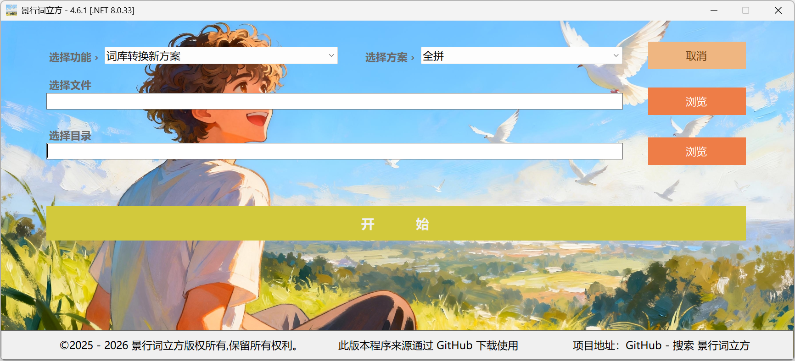

# 景行词立方

景行词立方是一款高度适配 Gboard 输入法词库处理的实用工具，第一个版本首次于2025年12月9日在GitHub发布。此程序提供多种音码方案之间的词库互转功能，具备备份与管理能力，在使用时带来便捷、高效、美观的词库方案管理体验。

## 界面预览

版本 5.x

版本 4.x

## 功能介绍

### 词库方案转换

支持 Gboard `.zip` 词库在不同拼音方案之间相互转换，涵盖全拼与双拼方案。4.x 及之前的版本支持完整 7 种方案互转，5.0 起调整为支持 4 种主流方案。

### 词库管理

除了方案转换，程序也提供较为完整的词库管理功能。使用时可以导入、导出和备份词库，也可以将多个词库合并自动去除重复，按需增删或编辑词条，并通过不同格式实现词库的整理与迁移。

### 自定义注音

针对多音词、生僻字词以及专有名词可能出现的注音偏差，程序提供了自定义注音规则。可以通过规则文件自定义词条的拼音，定义的优先词组第一顺位采用，以满足个性化的词库定制需求。

本项目预置了 1000 余条常用词组注音规则，同时支持自行添加、修改和删除规则，便于持续维护和扩展。

## 格式支持

| 格式 | 导入 | 导出 |
|---|:---:|:---:|
| Gboard `.zip` | ✓ | ✓ |
| 纯文本 `.txt` | ✓ | ✓ |
| 搜狗 `.scel` | ✓ | — |

## 运行环境

程序基于 C# 开发，目前仅面向 Windows x64 平台，运行可能需要安装 .NET 8 Runtime 或更高版本，具体以发行版本使用为准。

程序采用便携式设计无需安装，无需写入注册表，所有功能均可免费使用无限制，不含广告或内购。

## 使用说明

有关程序各项功能的操作方法，可参阅仓库提供的《使用说明》文件。自定义注音规则属于可选配置，词库转换推荐搭配使用准确率更高。

## 许可与免责声明

程序允许个人及商业场景免费使用，但不允许对程序进行二次修改。更多详细内容以仓库中的 LICENSE 文件或项目发布声明为准。

词库操作前建议保留原始备份，并在导入或导出后检查处理结果是否与预期一致。由于 Gboard 版本及系统环境存在差异，输入法更新也可能带来词库格式或处理规则的变化，无法保证程序适用所有环境无偏差正确运行，在使用过程中如发现错误或问题可通过议题反馈以便后续改进。

本程序按现有功能提供使用，不对因使用造成的数据损失或其他争议承担责任。使用者应自行确认操作结果，并遵守相关许可与使用规范。
